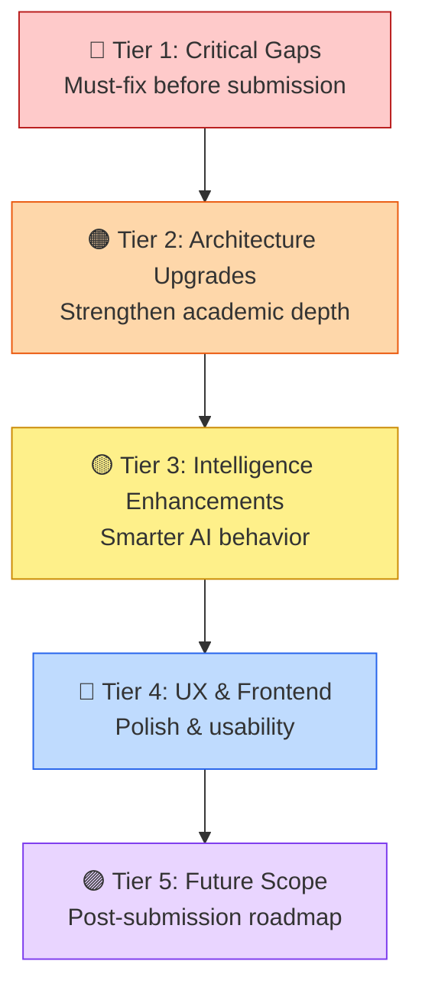

# FinSense (LedgerMind) — Proposed Modifications

**Date:** September 15, 2026  
**Current Status:** ~85-90% Complete ([see Work Status Report](file:///C:/Users/sivas/.gemini/antigravity-ide/brain/9d1be659-359d-4e91-b465-28675ab3d047/work_status.md))

---

## Modification Tiers Overview



---

## 🔴 Tier 1 — Critical Gaps (Must-Fix Before Submission)

### 1.1 Authentication & User Management System

**Problem:** The plan mandates Login/Signup (Week 10, Supporting Tier), and the Security Checklist requires *"per-user data isolation"* and *"passwords hashed (bcrypt)"* — none of which are implemented.

**Current State:** Zero authentication. All data is globally shared. No user sessions.

**Proposed Modification:**

| Component | Change |
|-----------|--------|
| [init_db.py](file:///c:/Users/sivas/Downloads/FINSENSE/backend/init_db.py) | Add `users` table: `id`, `username`, `email`, `password_hash`, `starting_balance`, `created_at` |
| [app.py](file:///c:/Users/sivas/Downloads/FINSENSE/backend/app.py) | Add `/api/auth/register`, `/api/auth/login` (returns JWT), `/api/auth/me` endpoints |
| [app.py](file:///c:/Users/sivas/Downloads/FINSENSE/backend/app.py) | Add `@require_auth` decorator that validates JWT and injects `user_id` into routes |
| `transactions` table | Add `user_id` column; all queries filter by `WHERE user_id = ?` |
| [App.jsx](file:///c:/Users/sivas/Downloads/FINSENSE/frontend/src/App.jsx) | Add Login/Signup page with JWT token stored in `localStorage`; redirect unauthenticated users |

**Implementation Approach:**
```python
# New dependency: PyJWT, bcrypt
import bcrypt, jwt

@app.route("/api/auth/register", methods=["POST"])
def register():
    hashed = bcrypt.hashpw(password.encode(), bcrypt.gensalt())
    # Insert into users table...

@app.route("/api/auth/login", methods=["POST"])
def login():
    token = jwt.encode({"user_id": user["id"], "exp": ...}, SECRET_KEY)
    return jsonify({"token": token})
```

**Effort:** ~4-5 hours | **Viva Value:** 🔥 High — demonstrates security awareness

---

### 1.2 Dedicated Fraud Alerts UI Page

**Problem:** The fraud/anomaly detection engine ([fraud_detector.py](file:///c:/Users/sivas/Downloads/FINSENSE/backend/evaluation/fraud_detector.py)) with Isolation Forest + Z-score is fully built and exposed via `/api/transactions/anomalies`, but there is **no dedicated Fraud Alerts tab** in the frontend sidebar — the plan requires it under Week 10.

**Current State:** Backend API exists but no UI to display it.

**Proposed Modification:**

| Component | Change |
|-----------|--------|
| [App.jsx](file:///c:/Users/sivas/Downloads/FINSENSE/frontend/src/App.jsx) | Add `'fraud'` tab in sidebar navigation between Cases and Settings |
| [App.jsx](file:///c:/Users/sivas/Downloads/FINSENSE/frontend/src/App.jsx) | Build `FraudAlertsPage` component: fetch `/api/transactions/anomalies`, render flagged transactions with risk scores, anomaly reasons, and severity badges |
| [App.css](file:///c:/Users/sivas/Downloads/FINSENSE/frontend/src/App.css) | Add styles for anomaly severity cards (red=high, yellow=medium, green=clean) |

**UI Design:**
```
┌─────────────────────────────────────────┐
│ 🛡️  Fraud & Anomaly Detection          │
│                                          │
│ ┌──────────┐ ┌──────────┐ ┌──────────┐ │
│ │ Analyzed │ │ Flagged  │ │ Risk     │ │
│ │   127    │ │    4     │ │  LOW     │ │
│ └──────────┘ └──────────┘ └──────────┘ │
│                                          │
│ ⚠️ ABC Traders — Rs. 1,20,000          │
│   Score: 87.3 | Z-Score Outlier         │
│   Reason: Amount 3.2σ above category    │
│                                          │
│ ⚠️ Duplicate: Metro Cash — Rs. 82,000  │
│   Score: 72.1 | Same-Day Duplicate      │
│   Reason: Same vendor+amount on 1 day   │
└─────────────────────────────────────────┘
```

**Effort:** ~2-3 hours | **Viva Value:** 🔥 High — directly demonstrates anomaly detection capability

---

### 1.3 Project Documentation & Final Report

**Problem:** The `docs/` folder is empty (only `.gitkeep`). Week 12 requires finalized documentation and a presentation.

**Proposed Modification:**

| File | Content |
|------|---------|
| `docs/architecture.md` | System architecture diagram (4-layer), data flow, component descriptions |
| `docs/api_reference.md` | All 22 API endpoints with request/response examples |
| `docs/evaluation_results.md` | OCR F1-score, Forecasting MAPE, Retrieval Precision@K — actual numbers from benchmark suite |
| `docs/user_guide.md` | How to set up, configure, and use the system |
| `docs/presentation/` | Final presentation slides (10-15 slides covering problem, architecture, demo, results, limitations) |

**Effort:** ~6-8 hours | **Viva Value:** 🔥🔥 Critical — you will be questioned on these

---

## 🟠 Tier 2 — Architecture Upgrades (Academic Depth)

### 2.1 Multi-User Database Schema Migration

**Problem:** Current schema has no `user_id` on `transactions` — all records are in a single global namespace. This contradicts the plan's security checklist requirement of *"per-user data isolation"*.

**Proposed Modification:**

```sql
-- Migration in init_db.py
ALTER TABLE transactions ADD COLUMN user_id INTEGER DEFAULT 1;
CREATE INDEX idx_transactions_user ON transactions(user_id);
```

| File | Change |
|------|--------|
| [init_db.py](file:///c:/Users/sivas/Downloads/FINSENSE/backend/init_db.py) | Add `user_id` column migration |
| [app.py](file:///c:/Users/sivas/Downloads/FINSENSE/backend/app.py) | Every `SELECT/INSERT/UPDATE/DELETE` on `transactions` adds `WHERE user_id = ?` |
| [rag_engine.py](file:///c:/Users/sivas/Downloads/FINSENSE/backend/fusion_engine/rag_engine.py) | `get_current_balance()` filters by user |
| [vector_store.py](file:///c:/Users/sivas/Downloads/FINSENSE/backend/case_memory/vector_store.py) | ChromaDB metadata includes `user_id` for isolation |

**Effort:** ~3-4 hours | **Viva Value:** 🔥 High — demonstrates scalability thinking

---

### 2.2 NLP Upgrade: Gemini-Powered Field Extraction (Hybrid Approach)

**Problem:** The current NLP extractor ([extractor.py](file:///c:/Users/sivas/Downloads/FINSENSE/backend/nlp/extractor.py)) uses only regex + keyword matching — entirely rule-based. This works for standard formats but fails on unusual layouts, handwritten notes, or non-English invoices.

**Current State:** Pure regex for vendor, amount, date, category, and transaction type.

**Proposed Modification:** Add a **Gemini LLM fallback** when regex extraction confidence is low.

```python
# In extractor.py — proposed hybrid approach
def extract_fields(raw_text):
    # Step 1: Try existing regex extraction
    result = extract_fields_regex(raw_text)
    
    # Step 2: Calculate confidence score
    confidence = calculate_confidence(result)
    
    # Step 3: If low confidence, call Gemini for LLM-assisted extraction
    if confidence < 0.6 and os.getenv("GEMINI_API_KEY"):
        llm_result = extract_fields_gemini(raw_text)
        result = merge_results(result, llm_result)
    
    return result
```

| Advantage | Detail |
|-----------|--------|
| Better vendor name extraction | LLM understands letterhead context, not just first-line heuristic |
| Handles Indian invoice formats | GST invoices, Tamil/Hindi invoices, handwritten receipts |
| Graceful degradation | Falls back to regex when API is unavailable (works offline) |

**Effort:** ~3-4 hours | **Viva Value:** 🔥🔥 Very High — shows evolution from rule-based → AI-powered

---

### 2.3 LSTM Forecasting Model

**Problem:** The plan lists *"LSTM"* as part of the forecasting layer, but only Prophet and ARIMA are implemented. This is a gap that could come up in the viva since the project documentation references PyTorch/LSTM.

**Proposed Modification:**

| File | Change |
|------|--------|
| `backend/forecasting/lstm_model.py` | [NEW] PyTorch LSTM with sliding window on daily balance data |
| [engine.py](file:///c:/Users/sivas/Downloads/FINSENSE/backend/forecasting/engine.py) | Add LSTM as a third model alongside Prophet and ARIMA |
| [app.py](file:///c:/Users/sivas/Downloads/FINSENSE/backend/app.py) | `/api/forecast` returns LSTM predictions alongside Prophet/ARIMA |
| [App.jsx](file:///c:/Users/sivas/Downloads/FINSENSE/frontend/src/App.jsx) | Add LSTM line in the forecast chart |

**Implementation Sketch:**
```python
import torch
import torch.nn as nn

class LSTMForecaster(nn.Module):
    def __init__(self, input_size=1, hidden_size=64, num_layers=2):
        super().__init__()
        self.lstm = nn.LSTM(input_size, hidden_size, num_layers, batch_first=True)
        self.fc = nn.Linear(hidden_size, 1)
    
    def forward(self, x):
        out, _ = self.lstm(x)
        return self.fc(out[:, -1, :])
```

**Effort:** ~4-5 hours | **Viva Value:** 🔥🔥 Very High — deep learning is expected

---

### 2.4 Move Voice Logic to Dedicated Module

**Problem:** The `backend/voice/` directory is empty (only `.gitkeep`). All voice logic lives scattered in [App.jsx](file:///c:/Users/sivas/Downloads/FINSENSE/frontend/src/App.jsx) (Web Speech API, Tamil TTS cleanup) and [app.py](file:///c:/Users/sivas/Downloads/FINSENSE/backend/app.py) (the `/api/tts` proxy). The folder structure in the plan shows `voice/` as a dedicated backend module.

**Proposed Modification:**

| File | Change |
|------|--------|
| `backend/voice/tts_engine.py` | [NEW] Extract `/api/tts` handler into dedicated module with Google TTS proxy + fallback |
| `backend/voice/stt_bridge.py` | [NEW] Server-side STT endpoint wrapping Google Cloud Speech API for more reliable recognition |
| `backend/voice/__init__.py` | [NEW] Module init |
| [app.py](file:///c:/Users/sivas/Downloads/FINSENSE/backend/app.py) | Import from `voice/` module instead of inline implementation |

**Effort:** ~1-2 hours | **Viva Value:** Medium — cleaner architecture

---

## 🟡 Tier 3 — Intelligence Enhancements (Smarter AI)

### 3.1 Feedback Loop Learning (Outcome → Case Memory Reweighting)

**Problem:** When a user marks a transaction outcome as "Healthy" or "Strained", this data is stored in ChromaDB but **doesn't influence future retrieval ranking**. The system retrieves by cosine similarity alone — it doesn't learn from past correct/incorrect predictions.

**Current State:** Outcomes are stored as metadata in ChromaDB but never used to reweight or re-rank results.

**Proposed Modification:**

```python
# In rag_engine.py — post-retrieval reranking based on outcome reliability
def rerank_cases_by_outcome_reliability(cases):
    """
    Boosts cases with verified outcomes (user-evaluated)
    over cases with only system-assigned labels.
    """
    for case in cases:
        outcome = case.get("outcome", "pending")
        if outcome in ["healthy", "strained"]:
            # User-verified outcomes get a 20% similarity boost
            case["similarity_score"] *= 1.20
        elif outcome == "pending":
            # Unverified cases get slight penalty
            case["similarity_score"] *= 0.85
    
    return sorted(cases, key=lambda x: x["similarity_score"], reverse=True)
```

**Impact:** The advisor gets smarter over time as users evaluate past decisions — this is the "learning from experience" narrative that makes the project compelling.

**Effort:** ~2-3 hours | **Viva Value:** 🔥🔥 Very High — demonstrates continuous learning

---

### 3.2 Recurring Expense Detection & Auto-Flagging

**Problem:** Many SME expenses are recurring (rent, electricity, internet, subscriptions) but the system treats every transaction as independent. It doesn't detect patterns like *"you pay TNEB Rs. 9,200 every month"*.

**Proposed Modification:**

| File | Change |
|------|--------|
| `backend/nlp/pattern_detector.py` | [NEW] Detect recurring vendor+amount patterns (monthly/quarterly/annual) |
| [app.py](file:///c:/Users/sivas/Downloads/FINSENSE/backend/app.py) | Add `/api/transactions/recurring` endpoint |
| [App.jsx](file:///c:/Users/sivas/Downloads/FINSENSE/frontend/src/App.jsx) | Dashboard card: "5 Recurring Expenses — Rs. 62,199/month" |

**Algorithm:**
```python
def detect_recurring_expenses():
    """
    Groups transactions by (vendor, amount ± 10% tolerance) and checks
    if they repeat with a roughly regular interval (28-35 days for monthly,
    85-95 days for quarterly).
    """
    # Group by vendor → sort by date → calculate inter-payment intervals
    # If median interval ≈ 30 days → flag as "Monthly Recurring"
    # If median interval ≈ 90 days → flag as "Quarterly Recurring"
```

**Impact:** Enables smarter forecasting (predicted expenses include known recurring obligations) and better advisory context.

**Effort:** ~3 hours | **Viva Value:** 🔥 High — shows pattern recognition capability

---

### 3.3 Smart Notification System (Balance Alerts)

**Problem:** The system calculates risk status (`healthy` / `strained`) based on balance vs threshold, but **never proactively alerts** the user. The user has to manually check the dashboard.

**Proposed Modification:**

| Component | Change |
|-----------|--------|
| [app.py](file:///c:/Users/sivas/Downloads/FINSENSE/backend/app.py) | After every transaction mutation, check if balance crossed below threshold → create alert record |
| `backend/notifications.py` | [NEW] Alert queue: balance warnings, forecast risk alerts, anomaly detections |
| [App.jsx](file:///c:/Users/sivas/Downloads/FINSENSE/frontend/src/App.jsx) | Notification bell icon in header with dropdown showing active alerts |
| `/api/notifications` | [NEW] GET (fetch alerts), PUT (mark as read) |

**Alert Types:**
1. ⚠️ **Balance Warning** — "Your balance dropped below Rs. 10,000"
2. 📉 **Forecast Risk** — "Prophet predicts balance will go below threshold in 12 days"
3. 🔴 **Anomaly Detected** — "Unusual transaction flagged: Rs. 1,20,000 to vendor X"
4. 📋 **Outcome Reminder** — "3 transactions from 30+ days ago still await outcome review"

**Effort:** ~3-4 hours | **Viva Value:** 🔥 High — proactive intelligence

---

### 3.4 Advisor Conversation History

**Problem:** The Advisor page is stateless — each query is independent. There's no conversation context. The user can't say *"what about if I negotiate the price to Rs. 50,000 instead?"* because the previous query is lost.

**Proposed Modification:**

| Component | Change |
|-----------|--------|
| [App.jsx](file:///c:/Users/sivas/Downloads/FINSENSE/frontend/src/App.jsx) | Store `advisorHistory` as an array of `{ query, result }` pairs |
| [rag_engine.py](file:///c:/Users/sivas/Downloads/FINSENSE/backend/fusion_engine/rag_engine.py) | Accept optional `conversation_history` in the prompt payload; include last 2-3 exchanges as context |
| UI | Render conversation as a scrollable chat timeline instead of single query/response |

**Effort:** ~3 hours | **Viva Value:** 🔥 High — conversational AI is expected in modern systems

---

## 🔵 Tier 4 — UX & Frontend Improvements

### 4.1 Responsive Mobile Layout

**Problem:** The 3,645-line [App.jsx](file:///c:/Users/sivas/Downloads/FINSENSE/frontend/src/App.jsx) uses fixed pixel widths and a desktop sidebar layout. On mobile screens, the sidebar and dashboard cards will overflow/collapse.

**Proposed Modification:**

| File | Change |
|------|--------|
| [App.css](file:///c:/Users/sivas/Downloads/FINSENSE/frontend/src/App.css) | Add `@media (max-width: 768px)` breakpoints: collapsible hamburger sidebar, stacked cards, smaller charts |
| [App.jsx](file:///c:/Users/sivas/Downloads/FINSENSE/frontend/src/App.jsx) | Add `isMobileView` state + `useState` for sidebar toggle |

**Effort:** ~3-4 hours | **Viva Value:** Medium — shows responsive design awareness

---

### 4.2 Dark Mode Toggle

**Problem:** The application only has a light theme. Modern financial dashboards typically offer dark mode for extended use.

**Proposed Modification:**

| File | Change |
|------|--------|
| [App.css](file:///c:/Users/sivas/Downloads/FINSENSE/frontend/src/App.css) | Add CSS custom properties for light/dark themes; toggle via `data-theme` attribute on `<body>` |
| [App.jsx](file:///c:/Users/sivas/Downloads/FINSENSE/frontend/src/App.jsx) | Theme toggle switch in Settings page; persist preference in `localStorage` |

**Effort:** ~2 hours | **Viva Value:** Low — nice polish

---

### 4.3 Data Export (CSV/PDF Reports)

**Problem:** Users can download individual invoice PDFs but cannot export their full transaction history or generate summary reports.

**Proposed Modification:**

| Component | Change |
|-----------|--------|
| [app.py](file:///c:/Users/sivas/Downloads/FINSENSE/backend/app.py) | Add `/api/transactions/export?format=csv` and `/api/reports/monthly` endpoints |
| [App.jsx](file:///c:/Users/sivas/Downloads/FINSENSE/frontend/src/App.jsx) | "Export CSV" button on Transactions page; "Download Monthly Report" on Dashboard |

**Export Formats:**
- **CSV** — Full transaction table with all columns
- **Monthly PDF Report** — Summary: opening balance, total income, total expenses, closing balance, top vendors, category breakdown, risk status

**Effort:** ~3 hours | **Viva Value:** Medium — practical business feature

---

### 4.4 Onboarding Wizard for New Users

**Problem:** A new user lands on an empty dashboard with no data, no guidance, and no starting balance configured.

**Proposed Modification:**

| Component | Change |
|-----------|--------|
| [App.jsx](file:///c:/Users/sivas/Downloads/FINSENSE/frontend/src/App.jsx) | On first load (0 transactions), show a guided wizard: 1) Set starting balance → 2) Upload first invoice or enter manual transaction → 3) Ask first advisor question |

**Effort:** ~2 hours | **Viva Value:** Low — UX polish

---

## 🟣 Tier 5 — Future Scope (Post-Submission Roadmap)

> [!NOTE]
> These are **not expected before submission** but are excellent to mention in your documentation and viva as *"future work"* — demonstrating you've thought beyond the current scope.

### 5.1 Bank API Integration (Open Banking)

Replace the manual starting-balance + transaction-entry approach with **real bank account data** via APIs:
- **RBI Account Aggregator Framework** — real-time bank balance and transaction feeds
- **Plaid / Yodlee** — international equivalent
- Automatic transaction categorization from bank data

### 5.2 GST Auto-Filing Integration

For Indian SMEs, auto-generate **GSTR-1 and GSTR-3B** return data from transaction records:
- Extract GSTIN numbers from invoices via OCR
- Calculate tax liability from income/expense categorization
- Generate GST return CSV in government-prescribed format

### 5.3 WhatsApp Business Bot

Expose the Advisor engine via WhatsApp Business API:
- User sends a photo of an invoice → OCR processes it → balance updates
- User asks "Should I buy 10 laptops?" → RAG engine responds with advice
- Daily balance summary notification at 9 AM

### 5.4 Mobile App (React Native)

Convert the React frontend to React Native for iOS/Android:
- Camera-based invoice scanning (direct phone camera → OCR)
- Push notifications for balance alerts and anomaly detections
- Offline mode with local SQLite sync

### 5.5 Multi-Business / Multi-Branch Support

Scale from single-business to franchise/multi-branch:
- Each branch has its own transaction namespace
- Consolidated view at the owner level
- Cross-branch anomaly detection (e.g., one branch spending 3x more than others)

### 5.6 Collaborative Decision Making

Allow multiple users (e.g., business owner + accountant) to:
- Comment on transactions
- Approve/reject proposed expenditures before execution
- Shared case memory where the accountant's outcome evaluations train the advisor

---

## Priority Recommendation Matrix

| # | Modification | Tier | Effort | Viva Impact | Recommend |
|---|-------------|------|--------|-------------|-----------|
| 1.1 | Authentication & Login | 🔴 Critical | 4-5 hrs | 🔥 High | ✅ Do it |
| 1.2 | Fraud Alerts UI Page | 🔴 Critical | 2-3 hrs | 🔥 High | ✅ Do it |
| 1.3 | Documentation & Report | 🔴 Critical | 6-8 hrs | 🔥🔥 Critical | ✅ Do it |
| 2.2 | Gemini NLP Hybrid | 🟠 Architecture | 3-4 hrs | 🔥🔥 Very High | ✅ Do it |
| 2.3 | LSTM Forecasting | 🟠 Architecture | 4-5 hrs | 🔥🔥 Very High | ✅ Do it |
| 3.1 | Feedback Loop Learning | 🟡 Intelligence | 2-3 hrs | 🔥🔥 Very High | ✅ Do it |
| 3.2 | Recurring Expense Detection | 🟡 Intelligence | 3 hrs | 🔥 High | ✅ Do it |
| 3.4 | Advisor Chat History | 🟡 Intelligence | 3 hrs | 🔥 High | ⚡ If time |
| 3.3 | Smart Notifications | 🟡 Intelligence | 3-4 hrs | 🔥 High | ⚡ If time |
| 2.1 | Multi-User DB Schema | 🟠 Architecture | 3-4 hrs | 🔥 High | ⚡ If time |
| 4.1 | Mobile Responsive | 🔵 UX | 3-4 hrs | Medium | ⚡ If time |
| 4.3 | Data Export CSV/PDF | 🔵 UX | 3 hrs | Medium | ⚡ If time |
| 2.4 | Voice Module Refactor | 🟠 Architecture | 1-2 hrs | Medium | ⚡ Quick win |
| 4.2 | Dark Mode | 🔵 UX | 2 hrs | Low | 💤 Optional |
| 4.4 | Onboarding Wizard | 🔵 UX | 2 hrs | Low | 💤 Optional |

---

> [!IMPORTANT]
> **If you can only do 3 things before submission:**
> 1. **Documentation & Report** (1.3) — you will fail the viva without it
> 2. **LSTM Forecasting** (2.3) — your plan promises it, the viva panel will ask about it
> 3. **Fraud Alerts UI** (1.2) — 2-hour effort to make your anomaly detection visible
