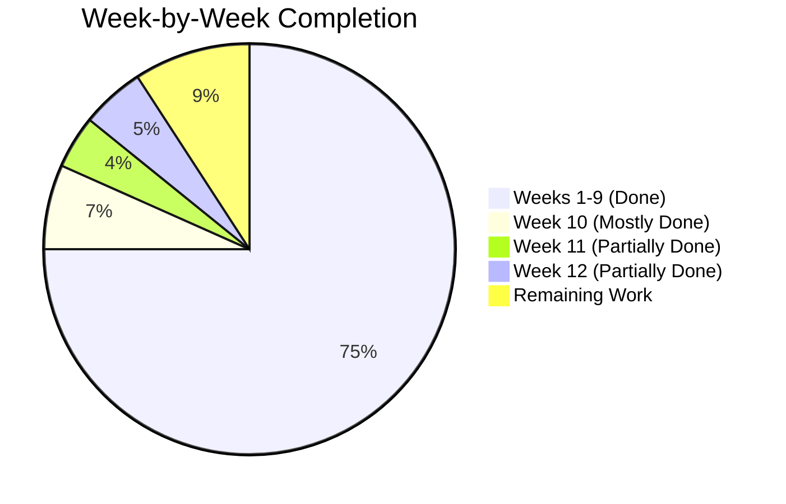
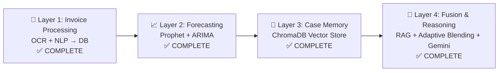

# FinSense (LedgerMind) — Project Work Status Report

**Assessed on:** September 15, 2026  
**Implementation Plan:** [FinSense_Implementation_Plan.md](file:///c:/Users/sivas/Downloads/FINSENSE/FinSense_Implementation_Plan.md)

---

## Overall Progress: ~85–90% Complete

---

## Week-by-Week Detailed Status

### ✅ Week 1 — Environment & Foundation — `COMPLETE`

| Task | Status | Evidence |
|------|--------|----------|
| Flask backend skeleton | ✅ Done | [app.py](file:///c:/Users/sivas/Downloads/FINSENSE/backend/app.py) — 1,341 lines, fully functional |
| React frontend skeleton (Vite) | ✅ Done | [App.jsx](file:///c:/Users/sivas/Downloads/FINSENSE/frontend/src/App.jsx) — 3,645 lines |
| Frontend ↔ Backend connectivity | ✅ Done | `/api/health` endpoint + CORS configured |
| SQLite schema with `transactions` table | ✅ Done | [init_db.py](file:///c:/Users/sivas/Downloads/FINSENSE/backend/init_db.py) — all columns including `transaction_type`, `outcome_date`, `outcome_notes` |
| `get_current_balance()` live-calculated | ✅ Done | Implemented in both [app.py:L76-99](file:///c:/Users/sivas/Downloads/FINSENSE/backend/app.py#L76-L99) and [rag_engine.py:L26-45](file:///c:/Users/sivas/Downloads/FINSENSE/backend/fusion_engine/rag_engine.py#L26-L45) |
| `get_balance_at_date()` for historical | ✅ Done | [app.py:L102-126](file:///c:/Users/sivas/Downloads/FINSENSE/backend/app.py#L102-L126) |
| `.env`, `.env.example`, `.gitignore` | ✅ Done | All present in backend |
| `requirements.txt` | ✅ Done | [requirements.txt](file:///c:/Users/sivas/Downloads/FINSENSE/backend/requirements.txt) |

---

### ✅ Week 2 — Invoice OCR Pipeline — `COMPLETE`

| Task | Status | Evidence |
|------|--------|----------|
| Tesseract OCR integration | ✅ Done | [pipeline.py](file:///c:/Users/sivas/Downloads/FINSENSE/backend/ocr/pipeline.py) — 168 lines |
| OpenCV preprocessing (deskew, grayscale, contrast, scaling) | ✅ Done | `preprocess_image_for_ocr()` with resize, deskew, Otsu thresholding |
| PDF support (pdfplumber + pypdfium2) | ✅ Done | Handles both scanned PDFs and text-based PDFs |
| Test on real invoices | ✅ Done | 20 real invoice images in `data/real_invoices/` + [test_ocr.py](file:///c:/Users/sivas/Downloads/FINSENSE/backend/ocr/test_ocr.py) |
| Additional test invoices | ✅ Done | 11 invoice PDFs in `invoices/` directory |

---

### ✅ Week 3 — NLP Field Extraction + Classification — `COMPLETE`

| Task | Status | Evidence |
|------|--------|----------|
| Vendor/client extraction | ✅ Done | [extractor.py](file:///c:/Users/sivas/Downloads/FINSENSE/backend/nlp/extractor.py) — regex + known vendor lookup |
| Amount, date, category extraction | ✅ Done | Multi-pattern regex with fallbacks |
| Transaction type classification (income/expense) | ✅ Done | Keyword + heuristic based classification |
| Category keyword mapping | ✅ Done | Education, Utilities, Software, Marketing, Shopping, Financial |
| Store structured records in DB | ✅ Done | [store_invoices.py](file:///c:/Users/sivas/Downloads/FINSENSE/backend/nlp/store_invoices.py) |
| Ground truth labels for evaluation | ✅ Done | [ground_truth.json](file:///c:/Users/sivas/Downloads/FINSENSE/data/real_invoices/ground_truth.json) — 20 labeled invoices |

---

### ✅ Week 4 — Dashboard & Transactions UI — `COMPLETE`

| Task | Status | Evidence |
|------|--------|----------|
| Dashboard page (live balance, stats, risk, charts) | ✅ Done | `activeTab === 'dashboard'` with cards, pie chart, category breakdown |
| Transactions list page with type badges | ✅ Done | `activeTab === 'invoices'` with search, filter by category/outcome |
| Category spend pie chart (Recharts) | ✅ Done | `PieChart` from Recharts with custom colors per category |
| Wired to real data | ✅ Done | `/api/dashboard/stats` and `/api/transactions` endpoints |
| Pending review count | ✅ Done | Deferred outcome lifecycle fully implemented |

---

### ✅ Week 5 — Forecasting Module — `COMPLETE`

| Task | Status | Evidence |
|------|--------|----------|
| Synthetic historical cash flow data | ✅ Done | [generate_data.py](file:///c:/Users/sivas/Downloads/FINSENSE/backend/forecasting/generate_data.py) → [historical_cashflow.csv](file:///c:/Users/sivas/Downloads/FINSENSE/data/synthetic/historical_cashflow.csv) (136KB) |
| Prophet model implementation | ✅ Done | [engine.py](file:///c:/Users/sivas/Downloads/FINSENSE/backend/forecasting/engine.py) with fallback regression if Prophet unavailable |
| ARIMA baseline comparison | ✅ Done | `statsmodels.tsa.arima.model.ARIMA` integrated |
| MAPE accuracy evaluation | ✅ Done | `evaluate_model_accuracy()` function |
| Forecast page UI (actual vs predicted chart) | ✅ Done | `activeTab === 'forecast'` with `ComposedChart`, Prophet + ARIMA lines, confidence bands |
| Risk alert for low cash prediction | ✅ Done | `/api/forecast` scans for dates below Rs. 10,000 threshold |

---

### ✅ Week 6 — Case Memory Foundation — `COMPLETE`

| Task | Status | Evidence |
|------|--------|----------|
| ChromaDB vector database setup | ✅ Done | [vector_store.py](file:///c:/Users/sivas/Downloads/FINSENSE/backend/case_memory/vector_store.py) — 331 lines, using `PersistentClient` with cosine similarity |
| Embeddings for transaction records | ✅ Done | Rich text representations with vendor, amount, type, category, outcome |
| Seed 50-100 synthetic case memories | ✅ Done | `seed_initial_cases()` with ~40+ realistic SME seed cases |
| Similarity retrieval function | ✅ Done | `query_similar_cases()` with semantic search |
| Add/retrieve/get_all cases | ✅ Done | Full CRUD + `/api/cases` and `/api/cases/query` endpoints |

---

### ✅ Week 7 — RAG + Fusion Engine & Advisor — `COMPLETE`

| Task | Status | Evidence |
|------|--------|----------|
| Gemini API integration | ✅ Done | [rag_engine.py](file:///c:/Users/sivas/Downloads/FINSENSE/backend/fusion_engine/rag_engine.py) — 727 lines, REST calls to `generativeContent` |
| RAG prompt construction (cases + forecast) | ✅ Done | Full context assembly with retrieved cases, forecast data, live balance |
| Multi-model fallback | ✅ Done | Tries `gemini-1.5-flash` → `gemini-2.0-flash` → `gemini-1.5-pro` → `gemini-2.0-flash-lite` |
| Advisor page UI (chat-style) | ✅ Done | `activeTab === 'advisor'` with query input, structured result display |
| Language support (English + Tamil) | ✅ Done | `advisorLang` toggle, auto-detects Tamil script in queries |

---

### ✅ Week 8 — Adaptive Blending Algorithm — `COMPLETE`

| Task | Status | Evidence |
|------|--------|----------|
| `confidence_weight` calculation | ✅ Done | `min(relevant_case_count / threshold, 1.0)` in RAG engine |
| Weight wired into prompt construction | ✅ Done | Generic vs. personalized emphasis based on case count |
| Tested across user stages (0, 6, 25 cases) | ✅ Done | Behavior adjusts based on available case memory density |

---

### ✅ Week 9 — End-to-End Integration — `COMPLETE`

| Task | Status | Evidence |
|------|--------|----------|
| Full pipeline: OCR → NLP → DB → Balance → Forecast → Case Memory → Fusion → UI | ✅ Done | All layers connected through [app.py](file:///c:/Users/sivas/Downloads/FINSENSE/backend/app.py) |
| Upload flow (file upload → parse → store → index → rebuild forecast) | ✅ Done | `/api/transactions/upload` endpoint |
| Manual entry flow | ✅ Done | `/api/transactions/manual` endpoint |
| Balance formula correctness verification | ✅ Done | [test_full_loop.py](file:///c:/Users/sivas/Downloads/FINSENSE/backend/evaluation/test_full_loop.py) — 5-stage integration test |
| Duplicate detection | ✅ Done | Prevents re-inserting same vendor/amount/date/type |
| ChromaDB sync on every transaction CRUD | ✅ Done | Add, update, delete all sync to vector store |
| Cashflow CSV rebuild on data changes | ✅ Done | `generate_historical_cashflow()` triggered after every mutation |

---

### ⚠️ Week 10 — Supporting Features (Tier 2) — `~80% COMPLETE`

| Task | Status | Evidence |
|------|--------|----------|
| Fraud/anomaly detection (Isolation Forest + Z-score) | ✅ Done | [fraud_detector.py](file:///c:/Users/sivas/Downloads/FINSENSE/backend/evaluation/fraud_detector.py) — Isolation Forest + statistical Z-score + heuristic patterns |
| Anomaly detection API | ✅ Done | `/api/transactions/anomalies` endpoint |
| Risk score calculation | ✅ Done | Based on balance vs threshold |
| Case Memory viewer page | ✅ Done | `activeTab === 'cases'` |
| Settings page | ✅ Done | `activeTab === 'settings'` — starting balance, alert threshold, Gemini model |
| Invoice PDF generation & download | ✅ Done | `/api/invoices/<id>/pdf` with ReportLab — professional PDFs |
| Transaction deduplication | ✅ Done | `/api/transactions/deduplicate` endpoint |
| Login/Signup page | ❌ Missing | No authentication system implemented |
| Fraud Alerts as a dedicated UI page | ⚠️ Partial | Anomaly data available via API but no dedicated "Fraud Alerts" tab in sidebar |
| `return_in`/`return_out` as separate types | ✅ Done | Schema supports them; classification is keyword-based |

---

### ⚠️ Week 11 — Voice Add-On (Tier 3) — `~70% COMPLETE`

| Task | Status | Evidence |
|------|--------|----------|
| Web Speech API: English speech-to-text | ✅ Done | `toggleSpeechRecognition()` in [App.jsx:L204-244](file:///c:/Users/sivas/Downloads/FINSENSE/frontend/src/App.jsx#L204-L244) |
| Text-to-speech output (English) | ✅ Done | Google Translate TTS proxy via `/api/tts` |
| Tamil output mode (Gemini → Tamil text → TTS) | ✅ Done | Full Tamil TTS with phonetic transliteration, number-to-Tamil-words conversion |
| Language toggle in UI | ✅ Done | `advisorLang` toggle (en/ta) on Advisor page |
| Dedicated `backend/voice/` module | ❌ Empty | Only `.gitkeep` — voice logic is in frontend (`App.jsx`) and `/api/tts` endpoint in `app.py` instead of a separate module |
| Tamil speech-to-text input | ⚠️ Partial | Recognition set to `ta-IN` locale, but depends on browser support |

---

### ⚠️ Week 12 — Evaluation, Testing, Documentation — `~60% COMPLETE`

| Task | Status | Evidence |
|------|--------|----------|
| NLP Extraction evaluation (Precision/Recall/F1) | ✅ Done | [benchmark_suite.py](file:///c:/Users/sivas/Downloads/FINSENSE/backend/evaluation/benchmark_suite.py) — `evaluate_nlp_extraction()` on real + synthetic |
| Forecasting evaluation (MAE/RMSE/MAPE) | ✅ Done | `evaluate_model_accuracy()` in forecasting engine, exposed via `/api/evaluation/metrics` |
| Retrieval evaluation (Precision@K) | ✅ Done | `evaluate_retrieval_precision()` in benchmark suite |
| Evaluation metrics API endpoint | ✅ Done | `/api/evaluation/metrics` |
| Ground truth data for real invoices | ✅ Done | [ground_truth.json](file:///c:/Users/sivas/Downloads/FINSENSE/data/real_invoices/ground_truth.json) — 20 labeled entries |
| User testing (5-10 people) | ❓ Unknown | No evidence of user test results or feedback collected |
| Final documentation | ⚠️ Partial | Implementation plan exists; no finalized project report/thesis document found |
| Final presentation | ❓ Unknown | No presentation slides found in `docs/` |

---

## Bonus Work (Beyond Original Plan)

These features were **not in the original plan** but have been built:

| Feature | Evidence |
|---------|----------|
| 🐳 Docker containerization (docker-compose) | [docker-compose.yml](file:///c:/Users/sivas/Downloads/FINSENSE/docker-compose.yml) + Dockerfiles for frontend & backend |
| 📄 Professional PDF invoice generation | `/api/invoices/<id>/pdf` with ReportLab — branded LedgerMind invoices |
| 🔍 Advanced transaction search (vendor, date range, amount range) | `/api/transactions/search` endpoint |
| ✏️ Deferred outcome lifecycle (pending → reviewed) | Full outcome evaluation workflow with notes, date, custom labels |
| 🧹 Transaction deduplication system | `/api/transactions/deduplicate` |
| 🔄 Transaction type correction API | `/api/transactions/<id>/type` |
| 🎯 Outcome recording with ChromaDB sync | `/api/transactions/<id>/outcome` |
| 🇮🇳 Tamil number-to-words conversion | Comprehensive `numberToTamilWords()` — Crores, Lakhs, Thousands |
| 📊 Sivam Traders synthetic business dataset | [sivam_traders_transactions.json](file:///c:/Users/sivas/Downloads/FINSENSE/data/synthetic/sivam_traders_transactions.json) — 233KB rich dataset |

---

## Remaining Work Summary

### 🔴 Critical (Should Complete)

| # | Item | Week | Effort |
|---|------|------|--------|
| 1 | **Final project documentation / report** | W12 | ~4 hrs |
| 2 | **Final presentation slides** | W12 | ~3 hrs |
| 3 | **Run and document user testing results** (5-10 people feedback) | W12 | ~3 hrs |

### 🟡 Recommended (High Value)

| # | Item | Week | Effort |
|---|------|------|--------|
| 4 | **Add a dedicated Fraud Alerts page/tab** in the sidebar (data already exposed via API) | W10 | ~2 hrs |
| 5 | **Login/Signup page** with bcrypt password hashing | W10 | ~4 hrs |
| 6 | Move voice logic to dedicated `backend/voice/` module (currently scattered in `app.py` and frontend) | W11 | ~1 hr |

### 🟢 Nice-to-Have (Low Priority)

| # | Item | Week | Effort |
|---|------|------|--------|
| 7 | Case memory `"outcome": "reversed"` annotation for returned expenses | W6/W10 | ~1 hr |
| 8 | LSTM model as an additional forecasting option | W5 | ~3 hrs |
| 9 | Security checklist completion (HTTPS, per-user isolation, file size limits) | W10 | ~2 hrs |
| 10 | `docs/` folder populated with architecture diagrams, API docs | W12 | ~2 hrs |

---

## Architecture Layer Completion

---

## API Routes Summary (20 endpoints built)

| Method | Route | Purpose | Status |
|--------|-------|---------|--------|
| GET | `/api/health` | Health check | ✅ |
| GET | `/api/dashboard/stats` | Dashboard aggregated stats | ✅ |
| GET | `/api/transactions` | List transactions (with filters) | ✅ |
| GET | `/api/transactions/pending-review` | Pending outcome reviews | ✅ |
| GET | `/api/transactions/search` | Advanced multi-criteria search | ✅ |
| POST | `/api/transactions/upload` | OCR file upload + parse | ✅ |
| POST | `/api/transactions/manual` | Manual transaction entry | ✅ |
| PUT | `/api/transactions/<id>/notes` | Update notes + sync ChromaDB | ✅ |
| PUT | `/api/transactions/<id>/outcome` | Record outcome evaluation | ✅ |
| PUT | `/api/transactions/<id>/type` | Update transaction type | ✅ |
| DELETE | `/api/transactions/<id>` | Delete transaction | ✅ |
| POST | `/api/transactions/deduplicate` | Remove duplicate records | ✅ |
| GET | `/api/balance` | Live-calculated balance | ✅ |
| GET | `/api/forecast` | Prophet + ARIMA forecast | ✅ |
| GET/POST | `/api/cases` | Manage case memories | ✅ |
| POST | `/api/cases/query` | Semantic case search | ✅ |
| POST | `/api/advisor/query` | RAG fusion advisor | ✅ |
| GET | `/api/tts` | Text-to-speech proxy | ✅ |
| GET | `/api/transactions/anomalies` | Fraud/anomaly detection | ✅ |
| GET/PUT | `/api/settings` | System settings | ✅ |
| GET | `/api/evaluation/metrics` | Benchmark metrics | ✅ |
| GET | `/api/invoices/<id>/pdf` | PDF invoice generation | ✅ |

---

## Frontend Pages (7 tabs built)

| Tab | Planned As | Status |
|-----|-----------|--------|
| Dashboard | Core Page #1 | ✅ Built |
| Invoices (Transactions) | Core Page #2 | ✅ Built |
| Upload (OCR + Manual) | Supporting | ✅ Built |
| Forecast | Core Page #3 | ✅ Built |
| Advisor | Core Page #4 | ✅ Built |
| Case Memory | Supporting | ✅ Built |
| Settings | Supporting | ✅ Built |
| Login/Signup | Supporting | ❌ Not built |
| Fraud Alerts | Supporting | ⚠️ API exists, no dedicated tab |

---

> [!IMPORTANT]
> **The core 4-layer architecture is fully complete and integrated.** All Core tier pages (Dashboard, Invoices, Forecast, Advisor) are functional. The main gaps are documentation/presentation deliverables for Week 12 and two Supporting-tier UI pages (Login, Fraud Alerts tab).
